  

  
  

  <!-- GitHub Trophies -->
  

I'm an industrial informatics engineering student at Politeknik Manufaktur Bandung. I build web apps with Laravel and Vue.js, mobile apps with Flutter and Kotlin, and write automated tests with Selenium and Pytest.

Right now I'm working on my final project (Tugas Akhir), and I'm open to freelance work.

## Stack

  
   
  Python tests run on Pytest.

<table>
<tr>
<td width="50%" valign="top">

## Weekly Development (WakaTime)

<!--START_SECTION:waka-->
<!-- WakaTime metrics akan otomatis muncul di sini -->
<!--END_SECTION:waka-->

</td>
<td width="50%" valign="top">

## Recent Activity

<!--START_SECTION:activity-->
<!-- Aktivitas terbaru akan otomatis muncul di sini -->
<!--END_SECTION:activity-->

</td>
</tr>
</table>

## On GitHub

  
  

## Projects

<table>
  <tr>
    <td width="50%" valign="top">
      <a href="https://github.com/bladecs/coconexus"><b>coconexus</b></a> 
      Web app for my final project 
      <code>Vue.js</code>
    </td>
    <td width="50%" valign="top">
      <a href="https://github.com/bladecs/wmt_company_profile"><b>wmt_company_profile</b></a> 
      Company profile website 
      <code>Vue.js</code>
    </td>
  </tr>
  <tr>
    <td width="50%" valign="top">
      <a href="https://github.com/bladecs/kanaya-kost"><b>kanaya-kost</b></a> 
      Boarding house (kost) management system 
      <code>Laravel</code> <code>Blade</code> <code>MySQL</code>
    </td>
    <td width="50%" valign="top">
      <a href="https://github.com/bladecs/E_Complaint"><b>E_Complaint</b></a> 
      Web-based complaint system 
      <code>Laravel</code> <code>Blade</code> <code>MySQL</code>
    </td>
  </tr>
  <tr>
    <td width="50%" valign="top">
      <a href="https://github.com/bladecs/ETN_SHOP"><b>ETN_SHOP</b></a> 
      Online shop 
      <code>PHP</code> <code>MySQL</code>
    </td>
    <td width="50%" valign="top">
      <a href="https://github.com/bladecs/Computer_Vision_3_Object"><b>Computer_Vision_3_Object</b></a> 
      Detects three objects with computer vision 
      <code>Python</code>
    </td>
  </tr>
  <tr>
    <td width="50%" valign="top">
      <a href="https://github.com/bladecs/Jadwal_Sholat_Mobile"><b>Jadwal_Sholat_Mobile</b></a> 
      Prayer times mobile app 
      <code>Flutter</code> <code>Dart</code>
    </td>
    <td width="50%" valign="top">
      <a href="https://github.com/bladecs/Jadwal_Sholat_TV"><b>Jadwal_Sholat_TV</b></a> 
      Prayer times app for TV 
      <code>Kotlin</code>
    </td>
  </tr>
</table>

## Testing

| Project | What it covers | Stack |
| :--- | :--- | :--- |
| [Selenium_Testing](https://github.com/bladecs/Selenium_Testing) | Browser automation tests | `Selenium` |
| [FintechGo-_Pytest](https://github.com/bladecs/FintechGo-_Pytest) | Tests for the FintechGo app | `Python` `Pytest` |
| [Whitebox_Testing_Dompet_Digital](https://github.com/bladecs/Whitebox_Testing_Dompet_Digital) | White-box testing of a digital wallet app | `Python` |
| [Test_SQA](https://github.com/bladecs/Test_SQA) | Software quality assurance tests | `PHP` |

 

  <!-- GitHub Snake Animation -->
  <picture>
    <source media="(prefers-color-scheme: dark)" srcset="https://raw.githubusercontent.com/bladecs/bladecs/output/github-snake-dark.svg">
    <source media="(prefers-color-scheme: light)" srcset="https://raw.githubusercontent.com/bladecs/bladecs/output/github-snake.svg">
    
  </picture>

---

  For a freelance project, email <a href="mailto:bladecs86@gmail.com">bladecs86@gmail.com</a> or message me on <a href="https://www.linkedin.com/in/hafizh-ahmad-al-mushoffi">LinkedIn</a>.

